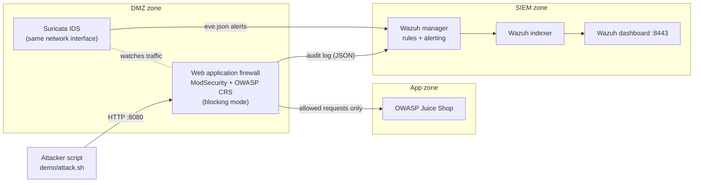
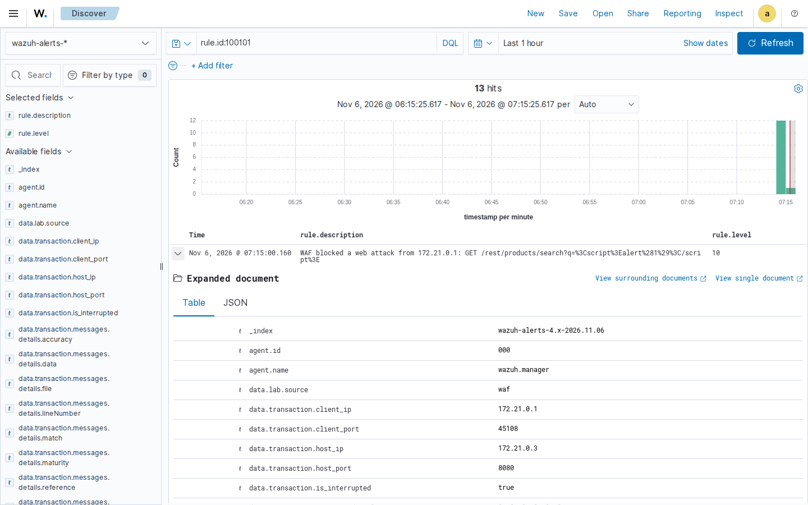
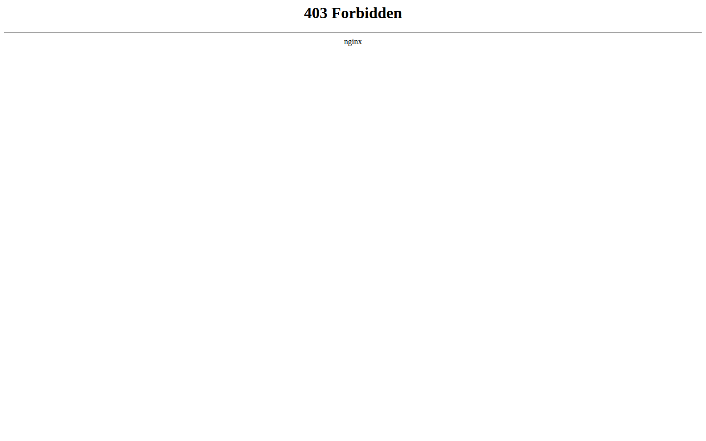
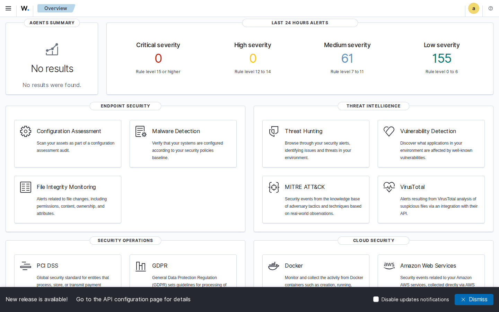

# Security Lab: SIEM, Web Application Firewall and Intrusion Detection

**Author: Aneis Samaan**

A small, self-contained security lab that shows three defensive layers catching a simulated web attack:

- **Web application firewall** — OWASP ModSecurity with the Core Rule Set, in blocking mode, protecting OWASP Juice Shop (a deliberately vulnerable web shop).
- **Intrusion detection** — Suricata watching the same traffic.
- **SIEM** — Wazuh (manager, indexer and dashboard) collecting the firewall's blocks and Suricata's alerts in one place.

Everything runs in Docker on a laptop, and the same setup is tested automatically on GitHub on every change.
All data is synthetic, and the attacks only ever target the lab's own containers.

## How it fits together

<!-- SCORECARD:START -->
## Latest results

From GitHub run [42179344856](https://github.com/cybersentien-ops5/security-lab/actions/runs/42179344856) (all checks passed). Full scorecard: [docs/proof/scorecard.md](docs/proof/scorecard.md) · [raw results for this run](../../tree/results/results/42179344856)

| Measure | Result |
|---|---|
| Attacks sent | 12 |
| Blocked by the web application firewall | 12 of 12 |
| Firewall alerts in the SIEM (Wazuh) | 12 |
| Suricata alerts in the SIEM (Wazuh) | 12 |
| Seconds from first attack to alert in the SIEM | firewall 6 s · Suricata 6 s |

**One alert in detail (WAF block, rule 100101)**

**A blocked request (the firewall's HTTP 403)**

**Wazuh overview**

<!-- SCORECARD:END -->

## Run it on a Mac

Needs Docker Desktop with at least 6 GB of memory (Docker Desktop > Settings > Resources).

1. Get the files: `git clone https://github.com/cybersentien-ops5/security-lab.git`
2. In the `demo` folder, double-click **start-demo.command** (first run downloads about 4 GB).
3. Double-click **attack-demo.command** to send the simulated attack and open the alerts.
4. Double-click **check-demo.command** for a PASS/FAIL line per part.
5. Double-click **stop-demo.command** when finished, to free the memory.

If macOS says the file is from an unidentified developer: right-click it, choose **Open**, then **Open** again.
A five-minute walkthrough script is in [demo/README.md](demo/README.md).

## What is tested on every change

The GitHub workflow [lab-lite](.github/workflows/lab-lite.yml) starts the whole lab on a free GitHub runner, runs the
attacks and passes only if: the firewall returns HTTP 403 for every attack, normal traffic still gets through, Wazuh holds
at least one firewall alert and one Suricata alert, and the dashboard loads. Each run stores its scorecard, screenshots and
log tails on the [`results` branch](../../tree/results/results). A separate [secret-lint](.github/workflows/secret-lint.yml)
workflow fails on any key or token pattern.

## Versions (all pinned)

Wazuh 4.9.2 · OWASP ModSecurity CRS 4.25.2 (nginx) · OWASP Juice Shop 17.1.1 · Suricata 7.0.17

## What comes next

See [docs/ROADMAP.md](docs/ROADMAP.md): zone firewall, certificates, MFA logins, data-leak detection,
automated response, ATT&CK simulation.
